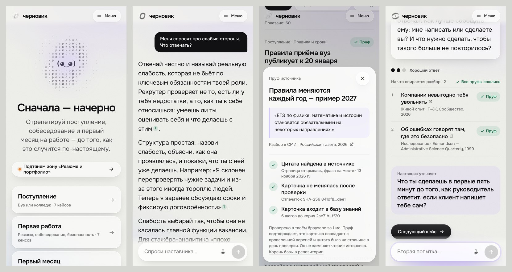

# Черновик

AI-тренажёр и собеседник для абитуриента и стажёра. Черновик даёт кейс с подвохом, разбирает ответ и показывает, как сказать лучше, а в общении отвечает на любые вопросы. У каждого факта есть источник и пруф.

Кейс «Цифровое наставничество и AI-менторство», Софтлайн Решения. Категория Lead, этапы 1–4.

[Открыть приложение](https://chernovik-hellowrld.vercel.app) · [Ролик, 1:21](docs/media/promo.mp4) · [Демо, 5 мин](docs/media/demo.mp4) · [Презентация](docs/presentation.pdf) · [Архитектура](docs/architecture.md) · [База знаний](docs/knowledge-base.md)

Если сайт не открывается, включи VPN или прокси: хостинг Vercel доступен не во всех сетях.



## Что умеет

**Тренажёр.** Три сценария: поступление, первая работа, первый месяц. В сессии четыре кейса. На каждый ответ — разбор в трёх блоках: что верно, что улучшить, удачный пример. Затем оценка и вторая попытка, которую Черновик сравнивает с первой. Отвечать можно текстом или голосом.

**Типовые ошибки.** Двадцать ошибок вроде «у меня нет слабых сторон» или «на платное подам потом». Черновик называет ошибку, объясняет, чем она мешает, и предлагает другую формулировку.

**Общение.** Отвечает на любой безопасный вопрос — от проходных баллов до того, что взять в общагу. Факты о поступлении, работе и законе идут с нумерованными сносками, бытовое — из общих знаний. После ответа три уточняющих вопроса.

**Поиск в интернете.** Если вопрос про конкретный вуз, компанию, город или сроки этого года, Черновик ищет в интернете. Сервер сам открывает каждую найденную страницу и оставляет только факты, чья дословная цитата там есть.

**Память.**

- Незакрытые ошибки и баллы по зонам хранятся в браузере. Следующая тренировка начинается с контрольного вопроса по прошлой ошибке.
- Подтверждённые факты из интернета сохраняются в «Мою базу», и Черновик опирается на них в следующих ответах.
- Разговоры не пропадают после перезагрузки.

**Чаты.** История последних 30 разговоров. В меню при наведении на «Чаты» выезжает список недавних, на отдельной странице — карточки разговоров. Любой можно открыть и продолжить.

**Знакомство.** Кто ты сейчас, что впереди и что тебе интересно. Интересы выбираются деревом: тема раскрывается в варианты (спорт → баскетбол, игры → Minecraft), можно добавить своё. В конце — заметка о себе текстом или голосом, маскот слушает и реагирует. Интересы уходят в каждый промпт: из них Черновик берёт примеры и аналогии.

**Свой Черновик.** Раздел «Кастом»: имя, цвет, тон от мягкого до строгого, подробность, юмор от «серьёзно» до «угарно» и манера — тёплая, деловая, с юмором, свой в доску, дерзкая или мемная. Превью сразу показывает, как он ответит, а настройки уходят в промпт вместе с вопросом. Своего Черновика можно показать друзьям карточкой. Внизу экрана — красная кнопка «Сбросить всё»: она стирает историю, прогресс и настройки и начинает с нуля.

**Скопировать.** Под ответом — кнопка, которая копирует вопрос, ответ и ссылки на источники.

**Экспорт.** Разбор сохраняется в PDF или в заметки в Markdown.

**Ценности.** Отдельный экран о принципах продукта: право на ошибку, решение за человеком, источник у каждого факта, память в браузере.

## Пруфы

Цифра-сноска в ответе открывает цитату из источника и три проверки, которые браузер делает сам:

1. **Цитата.** Скрипт `npm run proofs -- --fetch` нашёл дословную фразу на странице источника. Научные статьи сверяются по DOI в Crossref.
2. **Отпечаток.** SHA-256 карточки совпадает с проверенным. Изменилась буква — пруф не сойдётся.
3. **Дерево Меркла.** Путь от карточки сходится к корню базы из [`public/proofs.json`](public/proofs.json).

Для фактов из интернета цитату на странице проверяет сервер во время поиска, а браузер пересчитывает отпечаток. У «Моей базы» свой корень.

CI падает, если карточку изменили без новой проверки источника. Пруф подтверждает, что цитата была на странице в день проверки, но не заменяет чтение источника.

## Сценарии и база знаний

| Сценарий      | Зоны                                                                           | Карточек | Кейсов |
| ------------- | ------------------------------------------------------------------------------ | -------- | ------ |
| Поступление   | выбор направления, правила и сроки, стратегия подачи, обязательства и план Б   | 57       | 7      |
| Первая работа | резюме и портфолио, собеседование, стратегия поиска, права и безопасность      | 35       | 7      |
| Первый месяц  | ожидания и цели, вопросы и помощь, ошибки и обратная связь, испытательный срок | 22       | 7      |

114 карточек из 101 открытого источника: приказы Минобрнауки, правила приёма МГУ, ВШЭ, МФТИ, СПбГУ, МГТУ им. Баумана и ИТМО, Трудовой кодекс, 18 научных работ, материалы hh.ru, Т—Ж, «Российской газеты», РИА Новости, истории читателей. Список со ссылками — в [docs/knowledge-base.md](docs/knowledge-base.md), данные — в [knowledge/](knowledge).

## Этапы задания

| Этап                        | Что сделано                                                                         | Где смотреть                                     |
| --------------------------- | ----------------------------------------------------------------------------------- | ------------------------------------------------ |
| 1. База знаний и сценарии   | три сценария, 114 карточек с источниками и пруфами                                  | `knowledge/`, `scripts/`                         |
| 2. Два режима               | справка с источниками и поиском в интернете, тренажёр с кейсами, текст и голос      | `src/features/ask`, `src/features/train`         |
| 3. Обратная связь эксперта  | разбор в трёх блоках, каталог типовых ошибок с переформулировкой                    | `server/prompts.ts`, `knowledge/*/mistakes.json` |
| 4. Адаптивность и аналитика | память ошибок и зон, контрольные вопросы, карта прогресса, экспорт в PDF и Markdown | `core/progress.ts`, `src/features/report`        |

## Как устроено

React и TypeScript без UI-библиотек. Сервер — две функции Vercel: `/api/chat` ищет карточки, при необходимости ищет в интернете и отдаёт ответ модели потоком; `/api/transcribe` превращает запись голоса в текст. Ключ к модели хранится только на сервере.

Модель — `anthropic/claude-haiku-5.5` через OpenRouter, без скрытого размышления. Первые слова разбора появляются примерно через 0,7 с, весь разбор — за 3 с. Тренировка стоит около $0,003, ответ с поиском в интернете — около $0,02.

Подробности и принятые решения — в [docs/architecture.md](docs/architecture.md).

## Запуск

Нужен Node.js 22 и ключ [OpenRouter](https://openrouter.ai/keys).

```bash
npm install
cp .env.example .env   # вписать OPENROUTER_API_KEY
npm run dev
```

Проверки:

```bash
npm test                 # 119 тестов: поиск, промпты, пруфы, поток, память, голос, защита API
npm run check:knowledge  # целостность базы
npm run proofs:check     # пруфы совпадают с базой
npm run build
```

## Данные и этика

- Только открытые источники; у каждой карточки есть ссылка, издание, год и пруф.
- Цифры и нормы берутся из карточек, а из интернета — только с цитатой, найденной на странице. Если подтвердить нечего, Черновик говорит, где это проверить.
- Аккаунтов нет. Прогресс, разборы, профиль, разговор и личная база хранятся в браузере и удаляются из интерфейса. На сервер и модели уходит текст вопроса или ответа и профиль; имя и контакты не запрашиваются.
- Советы носят информационный характер и не заменяют официальные требования вузов и работодателей — эта оговорка есть на экранах и в PDF.

## Лицензия

MIT
