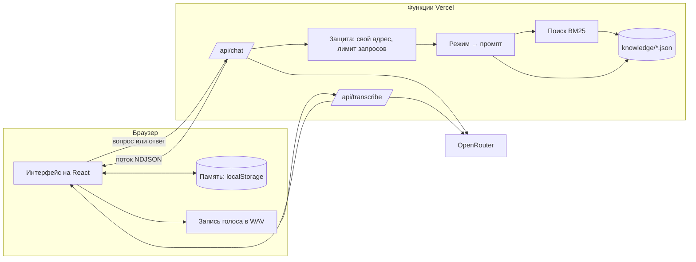

# Архитектура

## Схема



## Папки

| Папка        | Что внутри                                                                                   |
| ------------ | -------------------------------------------------------------------------------------------- |
| `knowledge/` | База знаний в JSON: сценарии, карточки, кейсы, типовые ошибки                                |
| `core/`      | Логика без привязки к браузеру и серверу: типы, поиск, формат обмена, память и подбор кейсов |
| `server/`    | Промпты, подготовка запроса к модели, клиент OpenRouter, защита API                          |
| `api/`       | Две функции Vercel — тонкие обёртки над `server/`                                            |
| `src/`       | Интерфейс: компоненты, экраны, запись голоса, хранение памяти                                |
| `scripts/`   | Проверка базы знаний и сборка её читаемой версии                                             |

`core/` используют и сервер, и интерфейс: поиск по карточкам работает в функции `/api/chat` и на экране «База».

## Путь запроса

**Справка.** Интерфейс отправляет историю диалога. Сервер ищет карточки по двум последним вопросам пользователя, кладёт до шести найденных в промпт и просит модель ставить после факта метку карточки: `[adm-priority-order]`. Интерфейс превращает метки в номера источников. После ответа модель пишет три уточняющих вопроса.

**Разбор кейса.** У кейса в базе есть критерии сильного ответа, связанные карточки и типовые ошибки — всё это уходит в промпт. Модель отвечает четырьмя блоками с метками на отдельных строках:

```
@@right     что верно
@@improve   что улучшить
@@example   удачный пример ответа
@@meta      {"score": 2, "mistakes": ["job-m-no-weakness"], "next": "уточняющий вопрос"}
```

Блоки показываются по мере генерации, служебный `@@meta` интерфейс разбирает сам. Текстовые метки вместо JSON-ответа выбраны ради потоковой выдачи: пользователь читает разбор с первой секунды.

**Итог сессии.** Сервер получает названия кейсов, баллы и ошибки и просит два блока: `@@summary` и `@@plan`.

## Поиск

Лексический BM25 по 57 карточкам с тремя добавками для русского языка:

- стеммер срезает окончания существительных и прилагательных;
- общий корень из четырёх букв связывает «уволить» и «увольнение» с пониженным весом;
- словарь разговорных форм: «собес», «испыталка», «накосячил».

Ниже порога релевантности поиск ничего не возвращает, и наставник честно говорит, что в базе ответа нет. Векторный поиск на таком объёме не дал бы выигрыша, зато добавил бы внешний сервис и задержку.

## Память и адаптивность

Память — чистые функции в `core/progress.ts`, хранение — `localStorage`.

- По каждой зоне копится доля набранных баллов. На карте прогресса она управляет резкостью точки: размытая — слабая зона.
- Каждая распознанная ошибка получает счётчик. Ошибка закрывается, когда пользователь даёт хороший ответ без неё в задании, где она возможна. Ошибка, исправленная только со второй попытки, остаётся открытой: её стоит проверить ещё раз без подсказки.
- Новая тренировка начинается с контрольного вопроса по открытой ошибке. Остальные кейсы ранжируются: слабая зона и проваленный раньше кейс поднимаются, пройденные опускаются, зоны не повторяются без нужды.

## Голос

Браузер записывает звук, приводит его к моно WAV 16 кГц и отправляет на `/api/transcribe`. Один путь работает в Chrome, Safari и Firefox, в отличие от встроенного распознавания речи. Текст попадает в поле ввода, его можно поправить перед отправкой.

## Экспорт

PDF делает сам браузер: у страницы разбора есть отдельные стили для печати. Так кириллица и типографика не зависят от библиотек. Кнопка «В заметки» отдаёт Markdown — через системное «Поделиться» на телефоне или файлом на компьютере.

## Защита ключа

- Ключ OpenRouter хранится в переменной окружения функции и в браузер не попадает.
- Промпты собираются на сервере: через API нельзя отправить модели произвольную инструкцию.
- Запросы принимаются только со своего адреса, действует лимит на IP и на длину сообщений.
- В кабинете OpenRouter стоит задать ключу потолок расходов.

## Модели

| Задача             | Модель                         | Почему                                                           |
| ------------------ | ------------------------------ | ---------------------------------------------------------------- |
| Наставник          | `anthropic/claude-haiku-5.5`   | находит те же ошибки, что и старшие модели; разбор за 3–7 секунд |
| Запасная           | `openai/gpt-5.6-luna`          | включается автоматически, если основная недоступна               |
| Распознавание речи | `google/gemini-3.1-flash-lite` | секунда на десять секунд записи                                  |

Сравнение шло на четырёх контрольных ответах: сильном, среднем, уверенно неверном и с ошибкой в норме закона. Все четыре модели, включая `claude-sonnet-5.5` и `gemini-3.8-flash`, распознали ошибки одинаково; выбрана самая дешёвая и быстрая.

Расход: разбор одного ответа — около 6 тысяч входных и 1,5 тысячи выходных токенов, тренировка целиком — примерно цент.

## Что дальше

- Профили вузов и компаний как отдельный слой карточек.
- Синтез речи, чтобы наставник задавал вопрос голосом.
- Синхронизация памяти между устройствами по коду без аккаунта.
- Telegram-бот поверх тех же функций `/api`.
