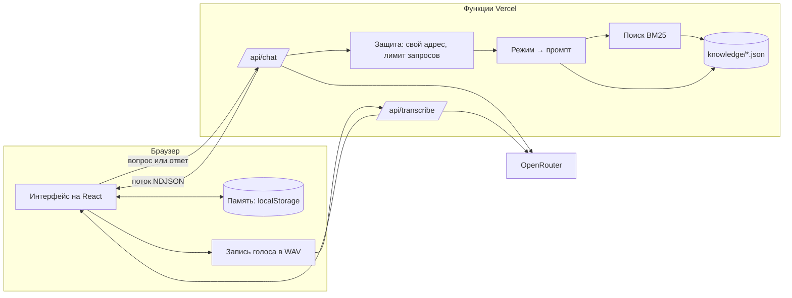

# Архитектура

## Схема



## Папки

| Папка        | Что внутри                                                                                   |
| ------------ | -------------------------------------------------------------------------------------------- |
| `knowledge/` | База знаний в JSON: сценарии, карточки, кейсы, типовые ошибки                                |
| `core/`      | Логика без привязки к браузеру и серверу: типы, поиск, формат обмена, память и подбор кейсов |
| `server/`    | Промпты, подготовка запроса к модели, клиент OpenRouter, защита API                          |
| `api/`       | Две функции Vercel — тонкие обёртки над `server/`                                            |
| `src/`       | Интерфейс: компоненты, экраны, запись голоса, хранение памяти                                |
| `scripts/`   | Проверка базы знаний, сборка пруфов и читаемой версии базы                                   |
| `public/`    | `proofs.json` — отпечатки карточек, пути до корня и результаты проверки источников           |

`core/` используют и сервер, и интерфейс: поиск по карточкам работает в функции `/api/chat` и на экране «База».

## Путь запроса

**Справка.** Интерфейс отправляет историю диалога. Сервер ищет карточки по двум последним вопросам пользователя, кладёт до шести найденных в промпт и просит модель ставить после факта метку карточки: `[adm-priority-order]`. Интерфейс превращает метки в номера источников. После ответа модель пишет три уточняющих вопроса.

**Разбор кейса.** У кейса в базе есть критерии сильного ответа, связанные карточки и типовые ошибки — всё это уходит в промпт. Модель отвечает четырьмя блоками с метками на отдельных строках:

```
@@right     что верно
@@improve   что улучшить
@@example   удачный пример ответа
@@meta      {"score": 2, "mistakes": ["job-m-no-weakness"], "next": "уточняющий вопрос"}
```

Блоки показываются по мере генерации, служебный `@@meta` интерфейс разбирает сам. Текстовые метки вместо JSON-ответа выбраны ради потоковой выдачи: пользователь читает разбор с первой секунды.

**Итог сессии.** Сервер получает названия кейсов, баллы и ошибки и просит два блока: `@@summary` и `@@plan`.

**Профиль.** К каждому запросу браузер добавляет то, что пользователь рассказал при знакомстве: этап, цели и пару слов о себе. Сервер оставляет только известные поля, обрезает текст до 300 символов и добавляет одну строку к системному промпту.

## Поиск в интернете

1. Сервер ищет карточки в базе и в присланной личной базе пользователя. Ответ модели сразу начинает генерироваться.
2. Параллельно маленькая модель (`gemini-3.1-flash-lite`, около 0,5 с) решает, нужен ли интернет: вопрос про конкретный вуз, компанию, город или цифры этого года. Если карточек меньше двух или пользователь нажал «Поискать в интернете», поиск идёт без вопроса.
3. Если нужен — начатый ответ отменяется, поток открывается сразу и показывает статусы: «Ищу в интернете», «Сверяю цитаты на страницах», «Пишу ответ».
4. Модель с веб-плагином OpenRouter возвращает до четырёх источников: адрес, дословную цитату и вывод (`server/web.ts`).
5. Сервер сам открывает каждую страницу, приводит её к тексту той же функцией, что и скрипт пруфов (`server/page-text.ts`), и ищет цитату. Что не нашлось — отбрасывается.
6. Подтверждённое становится карточкой `web-…` с отпечатком SHA-256 и временем проверки и идёт клиенту событием `found`, а модели — в промпт наравне с базой.

Браузер пересчитывает отпечаток веб-карточки и сверяет с отпечатком сервера. Подтверждённые карточки сохраняются сами и лежат в `localStorage` вместе с пруфом; личная база сворачивается в свой корень Меркла той же функцией, что и общая. До 24 сохранённых карточек уходят с вопросом, и сервер берёт из них до трёх самых близких к вопросу.

Поиск стоит около $0,02 и занимает 10–15 секунд, поэтому у него отдельный лимит — 10 поисков за 5 минут с адреса.

## Поиск

Лексический BM25 по 114 карточкам с тремя добавками для русского языка:

- стеммер срезает окончания существительных и прилагательных;
- общий корень из четырёх букв связывает «уволить» и «увольнение» с пониженным весом;
- словарь разговорных форм: «собес», «испыталка», «накосячил».

Ниже порога релевантности поиск ничего не возвращает, и наставник честно говорит, что в базе ответа нет. Векторный поиск на таком объёме не дал бы выигрыша, зато добавил бы внешний сервис и задержку.

## Память и адаптивность

Память — чистые функции в `core/progress.ts`, хранение — `localStorage`.

- По каждой зоне копится доля набранных баллов. На карте прогресса она управляет резкостью точки: размытая — слабая зона.
- Каждая распознанная ошибка получает счётчик. Ошибка закрывается, когда пользователь даёт хороший ответ без неё в задании, где она возможна. Ошибка, исправленная только со второй попытки, остаётся открытой: её стоит проверить ещё раз без подсказки.
- Новая тренировка начинается с контрольного вопроса по открытой ошибке. Остальные кейсы ранжируются: слабая зона и проваленный раньше кейс поднимаются, пройденные опускаются, зоны не повторяются без нужды.

## Голос

Браузер записывает звук, приводит его к моно WAV 16 кГц и отправляет на `/api/transcribe`. Один путь работает в Chrome, Safari и Firefox, в отличие от встроенного распознавания речи. Текст попадает в поле ввода, его можно поправить перед отправкой.

## Экспорт

PDF делает сам браузер: у страницы разбора есть отдельные стили для печати. Так кириллица и типографика не зависят от библиотек. Кнопка «В заметки» отдаёт Markdown — через системное «Поделиться» на телефоне или файлом на компьютере.

## Защита ключа

- Ключ OpenRouter хранится в переменной окружения функции и в браузер не попадает.
- Промпты собираются на сервере: через API нельзя отправить модели произвольную инструкцию.
- Запросы принимаются только со своего адреса, действует лимит на IP и на длину сообщений, у поиска в интернете — свой, строже.
- Карточки личной базы приходят от клиента, поэтому сервер принимает только поля нужной формы и длины.
- В кабинете OpenRouter стоит задать ключу потолок расходов.

## Модели

| Задача             | Модель                         | Почему                                                                    |
| ------------------ | ------------------------------ | ------------------------------------------------------------------------- |
| Наставник          | `anthropic/claude-haiku-5.5`   | находит те же ошибки, что и старшие модели; разбор в среднем за 3 секунды |
| Запасная           | `google/gemini-3.1-flash-lite` | включается автоматически, если основная недоступна                        |
| Распознавание речи | `google/gemini-3.1-flash-lite` | секунда на десять секунд записи                                           |

Сравнение шло на четырёх контрольных ответах: сильном, среднем, уверенно неверном и с ошибкой в норме закона. Все четыре модели, включая `claude-sonnet-5.5` и `gemini-3.8-flash`, распознали ошибки одинаково; выбрана самая дешёвая и быстрая.

Скрытое размышление модели выключено. С ним Haiku тратил около тысячи токенов перед ответом: первые слова приходили через 5 секунд, а цена была вдвое выше. Без размышления модель иногда принимала короткий ответ вроде «не знаю» за реплику в свой адрес, поэтому ответ пользователя приходит в явной рамке с напоминанием о формате. Запросы идут к площадке с наименьшей задержкой (`provider.sort = latency`).

Замеры на 41 прогоне всех кейсов и контрольных вопросов: первые слова в среднем через 0,7 секунды, весь разбор — за 3, формат выдержан в 40 случаях из 41. Разбор одного ответа — около 2,9 тысячи входных и 0,5 тысячи выходных токенов, $0,0005. Тренировка из четырёх кейсов с итогом — около $0,003.

`openai/gpt-5.6-luna` отвечал так же быстро и точно, но на новом аккаунте OpenRouter упирался в лимит запросов, поэтому запасной стала Gemini.

## Пруфы

Пруф карточки отвечает на три вопроса.

1. **Есть ли это в источнике.** У веб-карточки есть дословная цитата. Скрипт `scripts/proofs.ts` открывает страницу, приводит её к тексту и ищет цитату без учёта регистра, неразрывных пробелов и мягких переносов. Запросы к одному сайту идут по очереди, с повтором при лимите и обрыве. Научная статья проверяется по DOI в Crossref: название, первый автор и год выпуска.
2. **Не изменили ли карточку.** Отпечаток — SHA-256 от `"leaf:"` и канонического JSON карточки с отсортированными ключами. Проверка источника хранит отпечаток версии, для которой она сделана.
3. **Входит ли карточка в базу.** Отпечатки упорядочены по id и свёрнуты в дерево Меркла, узел — SHA-256 от `"node:"` и двух дочерних отпечатков. Разные префиксы не дают выдать узел за карточку.

Код проверки один — `core/proof.ts`, он работает и в Node, и в браузере через WebCrypto. Интерфейс подгружает `/proofs.json` только когда нужен пруф. Проверка всех 114 карточек занимает несколько миллисекунд.

CI запускает `npm run proofs:check`. Он падает, если манифест не совпадает с базой, если карточку изменили после проверки или если источник не подтвердился.

Пруф доказывает целостность и происхождение цитаты на дату проверки. Он не доказывает, что вывод в карточке единственно верный, и не заменяет чтение источника. Так и написано в интерфейсе.

## Интерфейс и производительность

- Шрифт Inter с оптическими размерами, подписи с заглавной буквы, стеклянные кнопки. Настоящее размытие подложки — только у плавающих элементов, под которыми едет контент: шапки, капсулы вкладок, поля ввода и окна пруфа.
- Шапки нет. Навигация — кнопка со знаком слева в поле ввода (на экранах без поля она висит в углу и прячется при прокрутке вниз). Она раскрывает стеклянное меню из пяти разделов с отдельной подложкой, а страница въезжает со стороны выбранного раздела. Стрелки, Home и End перемещают фокус, Escape закрывает меню и возвращает фокус к кнопке.
- Тепловые градиенты (`src/lib/aura.ts`) — несколько гауссовых пятен, пропущенных через палитру с полосами. Поле считается на холсте 48×48, браузер растягивает его, и размытие получается бесплатно.
- Знак — круг из точек с орбитальными волнами и радиальной рябью. Глаза собираются из той же сетки: внутри овала глаза точка вырастает до полной, в блике гаснет, а каждая точка догоняет свою цель с инерцией. Глаза следят за курсором, смотрят в поле, пока пользователь печатает, бегают, пока наставник думает, моргают и улыбаются при наведении. Всё рисуется на canvas и засыпает вне экрана и на скрытой вкладке; настройка уменьшения движения останавливает анимацию.
- Сценарии — карусель на цилиндре: прокрутка с привязкой к центру, а поворот, глубину и прозрачность каждой карточки CSS считает из одной переменной, которую JS обновляет раз в кадр.
- Голосовой шар — шейдер стоячих волн: радиальные и угловые моды складываются, узловые линии светлые, а плотность и сложность узора растут с громкостью.
- Ответ модели проявляется по словам: буфер догоняет поток примерно за 100 мс и отдаёт только целые слова, а каждое новое слово всплывает из размытия. Ключ слова — его номер в абзаце, поэтому React монтирует только новые слова и анимация не повторяется.
- Сноска в ответе открывает шторку с пруфом источника прямо поверх текста; список источников свёрнут в одну строку.
- Анимации страниц используют `backwards`, а не `both`. Иначе у страницы оставался бы `transform`, и все `position: fixed` внутри неё отсчитывались бы от страницы, а не от экрана. Окна пруфа и записи голоса рендерятся через портал в `body`.
- Голосовой шар считается в половине разрешения: он размытый по замыслу.
- При закрытии записи, отмене расшифровки и уходе со страницы освобождаются микрофон и аудиоконтекст. Окна голоса и пруфа удерживают клавиатурный фокус и возвращают его к вызвавшей кнопке.
- «Прогресс», «База», «Пруфы» и отчёт грузятся отдельными чанками.

- Маскот живой и на ощупь: у каждой точки есть смещение и скорость, пружина тянет её на место сетки. Курсор расталкивает ближние точки, клик даёт всем толчок от места клика — точки разлетаются и за полсекунды собираются обратно.
- След за курсором (`src/components/Trail.tsx`): на пустом фоне всплывают и гаснут радиальные «организмы» — актиния, радужка, коралл, солнце. Двенадцать образцов рисуются один раз на холсте (`src/lib/specimens.ts`), дальше это обычные картинки. Только мышь, не поверх текста и кнопок, выключено при «уменьшить движение».
- Живые надписи (`BlurCycle`): подсказка «Спроси …» в поле ввода и строка под маскотом сменяются по словам через размытие.
- «Свой наставник» (`src/features/mentor`): имя, цвет, тон, подробность и манера хранятся в браузере (`core/mentor.ts`) и уходят с каждым запросом; сервер приводит их к безопасному виду и добавляет короткий блок в конец системного промпта.
- Карточки для шеринга (`src/lib/shareCard.ts`) рисуются на холсте 1080×1350; если браузер умеет делиться файлами, открывается системное меню, иначе картинка скачивается.

## Что дальше

- Профили вузов и компаний как отдельный слой карточек.
- Синтез речи, чтобы наставник задавал вопрос голосом.
- Синхронизация памяти между устройствами по коду без аккаунта.
- Telegram-бот поверх тех же функций `/api`.
