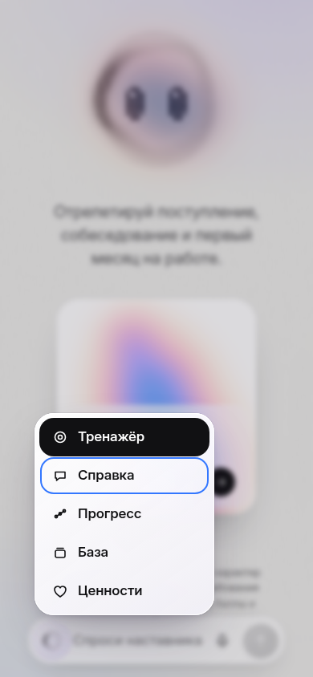
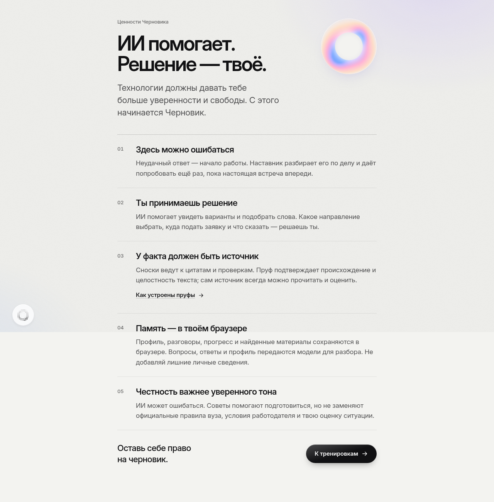
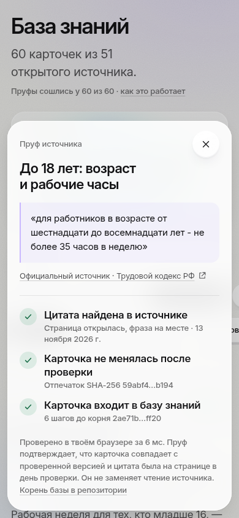

# Проверка Черновика · 14 ноября 2026

Ветка: `codex/glass-motion-audit`, коммит `ca1e3ac`. Основа: актуальный `main` (`d86fa70`). [PR #7](https://github.com/arniByte/ed_adviser/pull/7): CI и Vercel preview зелёные. В main не слито.

Финальные проверки: Prettier, TypeScript, 111 тестов (было 74), check:knowledge, proofs:check, production build, git diff --check — успешно.

## Проверенный путь

1. Знакомство → главная → меню разделов: скриншоты 390×844 и 1280×860. Меню теперь отделено от фона, фокус переходит к активному пункту; стрелки, Home/End, Escape, выбор активного пункта и переход к ценностям проверены.
2. Справка → реальный поток ответа → перезагрузка → веб-поиск → автосохранение источников в личную базу. Ошибки интерфейса и ответа HTTP 503 проверены отдельно с явным моком.
3. Тренировка «Первая работа»: четыре кейса, пять ответов с одной повторной попыткой, итог 11/12 и план. Шесть реальных ответов API HTTP 200, без ошибок JS/консоли. Память и отчёт сохранились после перезагрузки.
4. Отчёт: скачан Markdown, вызвана настоящая печать, экспорт A4 на четыре страницы осмотрен и проверен через pdftotext.
5. База → фильтр темы → поиск → пруф: 60 исходных карточек, 21 по работе, все 60 пруфов сходятся. Окно пруфа удерживает Tab/Shift+Tab, Escape возвращает фокус.
6. Голос: тестовый медиапоток Chromium проверил Tab/Shift+Tab/Escape, отмену, уход со страницы и позднее разрешение микрофона. Все tracks освобождаются, контекст закрывается. Это проверка жизненного цикла, не качества реального распознавания.
7. Большой и малый знак меняют изображение со временем; при reduced-motion bitmap статичен, переключение настройки оживляет его снова. Геометрия точек предвычислена, холсты засыпают вне экрана и на скрытой вкладке.

## Визуальные результаты

Открытое меню на 390 px после правки:

Новая страница ценностей:

Пруф остаётся читаемым поверх базы:

Скриншоты получены в текущем прогоне и осмотрены. В `axe-responsive.json` — 18 запусков axe (WCAG A/AA, 2.1/2.2) по главным экранам, меню и пруфу на двух ширинах: обнаруженных нарушений нет, горизонтальных переполнений нет. Это автоматическая проверка выбранных состояний, не заявление о полной доступности.

Дополнительно: меню помещается на 320×740 и 844×390; страница ценностей не переполняется при размере текста 200%. Длинные fullPage-скриншоты показывают стык fixed-фона на высоте viewport — это ограничение захвата, не подтверждённый баг прокрутки.

## Исправления

- Glass-кнопки получили световую кромку и объём; меню — плотную подложку, тень и отдельный затемнённый фон. Навигация и модальные окна доступны с клавиатуры.
- Повреждённые chat/mine/memory записи отбрасываются отдельно, без падения приложения и потери остальных валидных записей.
- Бюджет запроса учитывает историю и целые личные источники: до 24 карточек и 64 КБ UTF-8. Чтение потока обрабатывает последнюю строку, ошибку HTTP 200/SSE и освобождает reader/abort listener.
- Ошибка первого параллельного потока больше не даёт необработанный reject; веб-поиск получает текущий вопрос и предыдущий контекст раздельно.
- Устранены утечки микрофона и AudioContext. Расшифровку можно отменить.
- Уточнены приватность, подпись очистки прогресса и подсказка автосохранения личной базы; ошибки теперь красные.

## Сильные стороны

- Замкнутый сценарий репетиции: кейс → разбор → повтор → итог → память → экспорт.
- Доступные источники, дословная цитата и проверка целостности; аккуратные оговорки о пределах пруфа.
- Узнаваемая графика и небольшая архитектура без UI-библиотеки или обязательной регистрации.

## Остаточные риски и следующий приоритет

1. Качество разбора: в живом прогоне модель попросила назвать 35 часов, хотя пользователь уже назвал их, и одновременно похвалила это. Нужен набор контрольных ответов для оценки согласованности рубрики; ещё анимации этого не исправят.
2. Полнота веб-поиска зависит от доступности сайтов. В одном из прогонов при запросе правил МГУ четыре страницы не подтвердились; интерфейс честно сообщил об этом. Пруф не гарантирует, что вывод модели следует из цитаты.
3. Голосовые кодеки, разрешения Safari/Android и системное «Поделиться» нужно проверить на реальных устройствах. В этом прогоне использован Chromium.
4. В живой тренировке зафиксирован один `net::ERR_ABORTED` без сбоя интерфейса; точный запрос не сохранён. Не считать это подтверждённой регрессией без воспроизведения.
5. Всплывающая кнопка навигации может пересечь текст в нижнем углу до начала прокрутки; при прокрутке скрывается. Поиск/экспорт личной базы и синхронизация между устройствами остаются следующими функциями.
6. Сохранение найденного по повторному ID оставляет первую версию карточки. При отдельной задаче стоит продумать обновление версии с новым отпечатком, не подменяя старые пруфы.

## Материалы

Презентация пересобрана: 15 страниц, новый слайд ценностей, органическое кольцо и точные формулировки. Ролик: 82 с, 1920×1080,30 fps,H.264+AAC; полное декодирование без ошибок, звук без клиппинга. Сцена ценностей новая; старые записи интерфейса внутри ролика сохранены и не отражают новые кнопки/Mark. Сборщик и исходник сцены находятся в `../../tools/video/`.

В финальном живом прогоне после разделения текущего вопроса и контекста поиск по МГУ нашёл подтверждённый источник МГУ, а три найденных источника (две темы) сохранились в личной базе. Скриншот: `live-web-answer.png`. Ответы HTTP 200; получить полное тело потока через CDP в этом прогоне не удалось, поэтому `web-search.json` не следует трактовать как полную трассу событий. Проверка опиралась на завершённые блоки ответа, пруфы и сохранённую базу в интерфейсе.
